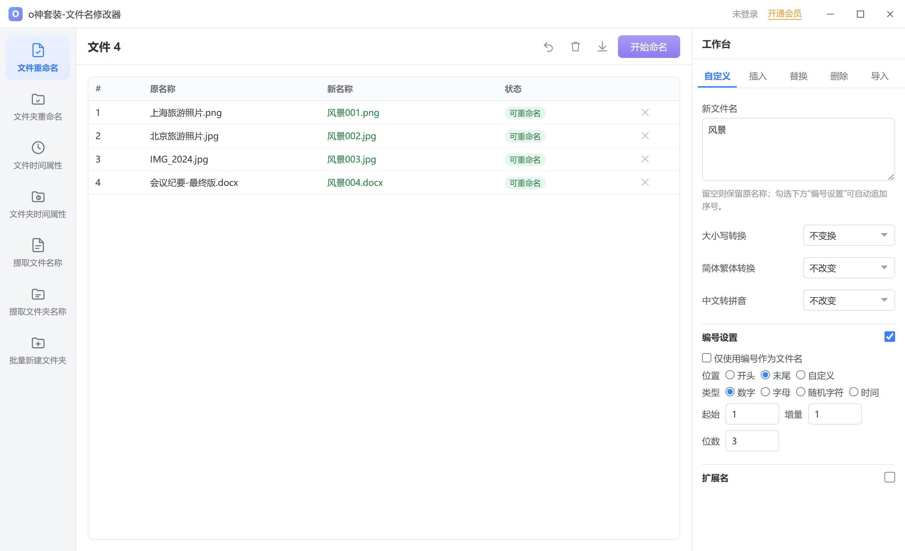

# o神套装-文件名修改器

Windows 桌面端批量文件名修改工具，基于 **Electron + Node.js**，全部逻辑本地运行，不联网、不上传文件。



## 下载

免安装包见 **[Releases](https://github.com/colicoyzo/oshen-win-unpacked/releases)**：

| 文件 | 说明 |
| --- | --- |
| `oshen-renamer-1.0.0-win-x64.zip` | 解压后双击 `o神套装-文件名修改器.exe` 运行，无需安装 |

支持 Windows 10 / 11 x64。未做代码签名，SmartScreen 可能提示「未知发布者」，点「更多信息 → 仍要运行」即可。

## 功能

| 模块 | 说明 |
| --- | --- |
| 文件重命名 | 批量改名，保留扩展名 |
| 文件夹重命名 | 同上，作用于文件夹（名称中的点不会被误判为扩展名） |
| 文件时间属性 | 批量修改「修改时间 / 访问时间」 |
| 文件夹时间属性 | 同上，作用于文件夹 |
| 提取文件名称 | 导出名称列表为 txt / csv |
| 提取文件夹名称 | 同上，作用于文件夹 |
| 批量新建文件夹 | 按名称列表批量建目录，支持自动编号 |

### 重命名规则（右侧工作台）

- **五种模式**
  - 自定义：固定新名；多行 = 词库，按文件顺序循环
  - 插入：开头 / 末尾 / 指定字符位置插入
  - 替换：查找替换，支持正则与忽略大小写
  - 删除：从头 / 尾 / 指定位置删除 N 个字符
  - 导入：从 txt / csv 读取名称列表（每行一个，自动识别 UTF-8 / GBK）
- **大小写转换**：不变换 / 全大写 / 全小写 / 首字母大写 / 大小写互换
- **简体繁体转换**：简→繁 / 繁→简（OpenCC）
- **中文转拼音**：全拼 / 全拼无空格 / 全拼首字母大写 / 首字母 / 首字母大写
- **编号设置**：位置（开头 / 末尾 / 自定义）× 类型（数字 / 字母 / 随机字符 / 时间）× 起始 / 增量 / 位数
- **扩展名**：自定义替换，或 `旧|新` 形式替换（如 `png|jpg`）

## 快速开始

```bash
npm install
npm start
```

Windows 用户也可直接双击 **`启动.bat`**。

## 打包

```bash
npm run dist                      # 安装包 + 便携版，输出到 dist/
npx electron-builder --win dir    # 仅生成免安装目录 dist/win-unpacked/
```

> 若报 `Cannot create symbolic link`：开启 Windows「开发人员模式」，或用管理员终端执行。

免安装版 `dist/win-unpacked/` 约 276MB（压缩后约 110MB），超出 GitHub 单文件 100MB 限制，故不纳入仓库。分发方式为 Release 附件：

```bash
npx electron-builder --win dir
node_modules/7zip-bin/win/x64/7za.exe a -tzip -mx=5 dist/oshen-renamer-1.0.0-win-x64.zip ./dist/win-unpacked/*
GH_TOKEN=xxx bash publish-release.sh    # 建 Release + 上传附件，可重复执行
```

`publish-release.sh` 会读取 `docs/release-notes-v<version>.md` 作为 Release 正文；同名 Release 已存在时复用并补充附件，不会重复创建。Token 需具备 `repo`（classic）或 `Contents: Read and write`（fine-grained）权限。

## 安全设计

- **实时预览**：改规则即时显示每项新名称与状态（可重命名 / 未变化 / 重名冲突）
- **冲突拦截**：批次内重名、目标已存在、名称超长、Windows 保留名（`CON`/`NUL`/`COM1`…）
- **两阶段改名**：源 → 临时名 → 目标名，避免互相占位与 Windows 大小写改名失败
- **一键撤销**：还原上一次批量重命名
- **非法字符**：自动替换为 `_`，去掉结尾的点与空格

## 目录结构

```
main.js             主进程：窗口、对话框、文件系统 IPC
preload.js          contextBridge 安全桥（contextIsolation 开启）
rename-engine.js    重命名引擎：规则计算 + 两阶段落盘 + 撤销 + 编码识别
src/index.html      界面结构
src/styles.css      界面样式
src/renderer.js     渲染层交互逻辑
test/               无头测试（引擎 / DOM / 真实磁盘 / 缺陷回归）
samples/            示例文件，可直接拖入试用
docs/               界面截图、Release 文案
publish-release.sh  发版脚本：建 Release + 上传附件
```

## 测试

```bash
npm test                   # 磁盘改名 / 规则回归 / 无头 DOM 三套测试
```

单独运行：

```bash
node test/disk-test.js     # 真实磁盘改名 + 撤销 + 冲突拦截
node test/fix-test.js      # 文件夹名 / 保留名 / GBK / 撤销等回归用例
node test/dom-test.js      # 无头 DOM 交互（依赖 jsdom）
node test/bug-repro.js     # 历史缺陷复现对照
```

可选：界面截图脚本需本机 Chrome 与 `playwright-core`：

```bash
npm i -D playwright-core
CHROME_PATH="/path/to/chrome" node test/screenshot.js
```

## 技术栈

- Electron 33（主进程 Node.js）
- [pinyin-pro](https://www.npmjs.com/package/pinyin-pro) 中文转拼音
- [opencc-js](https://www.npmjs.com/package/opencc-js) 简繁转换
- iconv-lite 文本编码识别

## License

[MIT](LICENSE)
